# Tomcat 구조와 학습 경계

기준은 Apache Tomcat 10.1.34다. 아래는 학습할 목표 흐름이다.

2026-11-10 현재 0~5단계를 구현했다. WrapperValve가 요청별 ApplicationFilterChain으로 Context 필터와 Servlet을 호출한다. 전체 Lifecycle·Server/Service/Connector 조립은 6단계 예정이다. 실제 결과는 [5단계 기록](../05-filter/01-filter-chain.md)을 따른다.

[인터랙티브 구조도](tomcat-architecture.html)를 브라우저로 열면 일반 요청과 JSP 요청의 호출·응답 복귀, Mapper 조회와 Pipeline 실행의 차이를 확인할 수 있다. JSP·Spring MVC 분기는 전체 구조를 설명하는 예시이며, 이 프로젝트의 필수 구현 범위는 사용자 디스패처를 실행하는 내장 컨테이너까지다.

```mermaid
flowchart LR
  Client[클라이언트] --> Endpoint[네트워크 Endpoint]
  Endpoint --> Processor[Coyote Http11Processor]
  Processor --> Adapter[Catalina CoyoteAdapter]
  Adapter --> Mapper[Mapper 선택]
  Mapper --> Mapping[MappingData]
  Mapping --> Engine[Engine Pipeline]
  Engine --> Host[Host Pipeline]
  Host --> Context[Context Pipeline]
  Context --> Wrapper[Wrapper Pipeline]
  Wrapper --> Filters[ApplicationFilterChain]
  Filters --> Servlet[Servlet]
```

Endpoint는 네트워크 유틸리티로 연결 수락·I/O 실행·소켓 종료를 담당한다. Coyote의 ProtocolHandler는 Endpoint와 Processor를 연결하고, Processor는 HTTP를 해석·준비한 뒤 Adapter 계약으로 애플리케이션 처리 경계를 넘는다. 응답이 돌아오면 HTTP 바이트를 전송한다.

Catalina의 CoyoteAdapter는 프로토콜 데이터를 컨테이너·서블릿 계약에 연결한다. Mapper는 Host·Context·Wrapper를 선택해 결과를 기록한다. 이후 Adapter가 Engine Pipeline으로 진입하고 계층별 기본 Valve가 선택된 다음 대상을 호출한다. Wrapper는 인스턴스를 관리하며 WrapperValve가 필터 체인을 통해 Servlet.service를 호출한다.

Server는 Service들을, Service는 Connector들과 Engine을 묶는다. Connector는 Catalina 쪽 구성요소로 ProtocolHandler와 Adapter를 연결한다. 이 구성 관계와 요청 한 건의 호출 순서를 구별해야 한다. 시작·종료는 개별 요청보다 긴 자원 수명을 다룬다.

| 구성요소 | 해결하는 문제 | 단계 |
|---|---|---|
| Endpoint·Processor | 소켓 관리와 HTTP 판단의 변화가 섞임 | 1→2 |
| Adapter·서블릿 요청/응답 | 프로토콜 데이터와 앱 API의 결합 | 3 |
| Wrapper | 초기화·재사용·해제 소유권 | 3 |
| Host·Context | 서버명과 웹앱의 경계 | 4 |
| Mapper·MappingData | 선택과 실제 호출의 결합 | 4 |
| Pipeline·Valve | 컨테이너별 공통 처리 확장 | 4→5 |
| FilterChain | 앱 요청의 전후·중단 처리 | 5 |
| Lifecycle·Server·Service·Connector | 시작 실패와 종료 순서·자원 누수 | 6 |
| SimpleTomcat | 사용자의 내부 조립 의존 | 7 |

1단계 단일 서버와 3단계 고정 Wrapper는 중간 모델이다. 실제 Tomcat의 완성 구조로 설명하지 않는다. 클래스 분리만으로 느린 연결은 해결되지 않으므로 동시성과 읽기 타임아웃은 6단계에서 별도로 검증한다.

Tomcat Mapper는 서블릿을 선택한다. 사용자 DispatcherServlet은 그 안에서 업무 핸들러를 선택한다. Jasper는 JSP를 서블릿으로 변환·컴파일·로딩하는 별도 하위 시스템이다.

[소스 지도](../reference/01-tomcat-source-map.md) · [범위와 차이](../reference/02-scope-and-differences.md)
